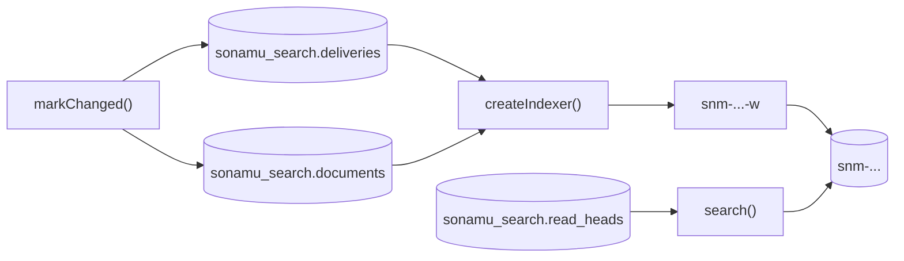

`@sonamu-kit/opensearch` is an optional package that indexes a Sonamu application's PostgreSQL data in OpenSearch and searches it. Each domain transaction records in PostgreSQL which documents changed; a separate worker reads those records and applies them to OpenSearch. Searches read only the index that the PostgreSQL catalog points to.

Read this page to decide whether the package fits your application, then continue with [Setup](/en/advanced-features/opensearch/setup).

## What it does and does not do

The package:

- Records the indexing intent in the same PostgreSQL transaction as the domain write. A domain write never sends a request to OpenSearch.
- Applies those intents to OpenSearch with a worker. If a document is sent more than once or a request arrives late, the highest revision stays.
- Rebuilds when a definition changes: it fills a new index from the PostgreSQL source, then switches searches to it by moving a read pointer.
- Takes native OpenSearch DSL as the search body and passes only the keys it allows.

The package does not:

- Detect table changes. There is no CDC, no trigger, and no entity decorator; the application calls `markChanged` on every write path that affects the index.
- Create a schema or an index when the server starts. The application's migration installs the schema, and an operator creates indexes with administrative commands.
- Ship analyzers, dictionaries, or mappings. A definition carries OpenSearch settings JSON as is.
- Decide authorization. Who may see a search result is the application's call.

## Guarantees and non-guarantees

| Property | Behavior |
| --- | --- |
| Domain write and indexing intent | Recorded on the same connection in the same transaction. If the intent cannot be recorded, the transaction does not commit (fail-closed). |
| Delivery | At least once. The same document may be sent more than once. |
| Ordering | Each document's ledger revision is sent as the OpenSearch external version. The engine rejects a late request with a lower revision. |
| Search visibility | Eventually consistent. A change becomes searchable after the worker processes it and the index refreshes. |
| OpenSearch outage | Domain writes continue. Intents accumulate in PostgreSQL and the worker processes them when the outage ends. |
| Search results | Candidates, not authorized records. |

What the package does not guarantee:

- **Exactly-once delivery.** When the same revision is sent twice, the second request fails with a version conflict; the worker records the document as done only after confirming that the indexed content equals what it tried to send.
- **That commits and search results change together.** Code that expects a just-committed change to be searchable at once is wrong.
- **An unbounded buffer.** While the worker is stopped, intents and ledger rows keep accumulating in PostgreSQL. Monitor the backlog.

Search results are candidates because the index can lag: the tombstone of a deleted record may not be indexed yet, and permissions or content may have changed since indexing. Before responding, re-check the current record and its permissions on the primary using the IDs in the result. [Searching](/en/advanced-features/opensearch/searching) shows how.

## Moving parts

- **Ledger (`documents`)**: one revision per document, raised by one on each `markChanged` call. Deleting a document leaves its ledger row in place.
- **Intents (`deliveries`)**: one row per target saying "send this document up to this revision". This is the outbox.
- **Worker**: claims intents under a lease, runs the projection in a read-only snapshot of the primary, and sends the results in bulk requests.
- **Target**: a versioned physical index `snm-<namespace>-<logical key>-<target ID>` plus the alias `<physical index>-w` the worker writes through. A definition change means a new target.
- **Read pointer (`read_heads`)**: which target searches read. It lives in PostgreSQL rather than in an OpenSearch alias, so cutover and rollback happen in a transaction.

All of these tables live in a dedicated schema (`sonamu_search` by default), not in `public`, and none of them is a Sonamu entity.

### Three handles

Marking, indexing, and searching are separate handles.

| Handle | Factory | What it does |
| --- | --- | --- |
| Synchronization | `createPostgresSynchronization` | Records intents inside domain transactions |
| Worker | `createIndexer` | Applies intents to OpenSearch |
| Query | `createSearchQueries`, `createSonamuSearchQueries` | Searches the target the read pointer names |

An API process can therefore mark and search while the worker runs in another process. Creating a handle opens no connection, starts no timer, and touches no schema; connections open only on an actual operation or on `start()`. Installing the package turns nothing on.

## What the application owns

- **Projections**: the function that turns source rows into search documents, and the schema of those documents. See [Search definitions](/en/advanced-features/opensearch/definitions).
- **Mappings, settings, analyzers**: a definition's `settings` and `mappings` hold OpenSearch JSON as is. The package only checks their shape.
- **Authorization**: the search filter, and re-checking search results on the primary.
- **Marking every write path**: creates, updates, deletes, and changes the database makes on its own (foreign-key CASCADE and SET NULL) must all call `markChanged`. An unmarked change never reaches the index. See [Transactional indexing](/en/advanced-features/opensearch/transactional-indexing).
- **Operations**: PostgreSQL roles and OpenSearch credentials, running index creation and cutover, and monitoring the backlog.

## Supported versions

| Component | Range | Notes |
| --- | --- | --- |
| OpenSearch | 3.5.0 or later, below 4 | Integration tests use the 3.5.0 image by default and can run against the 3.9.0 image |
| PostgreSQL | 18 | The only version tested |
| `@opensearch-project/opensearch` | `^3.9.0` | Peer dependency. The application creates the client and passes it in |
| `knex` | `^3.3.0` | Peer dependency |
| `sonamu` | `>=0.13.9` | Optional peer dependency, needed only by the `/sonamu` entry point |
| Node.js | 24 or later | |

### Analyzer plugins

The package neither ships nor requires analyzers. If you need a morphological analyzer, install the OpenSearch plugin on the cluster yourself and list its name in the definition's `requiredPlugins`. The administrative handle checks that list at two points:

- `planCreate` checks every node, lists missing plugins in `missingPlugins`, and only adds a `plugins-missing` warning.
- The actual creation (`executeCreate`, and `beginRebuild`, which takes the same path) refuses with `plugins-missing` before any remote command or PostgreSQL write if a plugin is missing.

Plugins are tied to engine versions. The following was observed with the official images in November 2026 and is not something the package tests: on OpenSearch 3.5.0, `analysis-nori` and `analysis-sudachi` 3.6.0 both installed; on OpenSearch 3.9.0 the Sudachi plugin did not install, because its newest release targeted 3.5.0. If you need Japanese analysis, check plugin support yourself before upgrading the engine.

## Next steps

<CardGroup cols={2}>
  <Card title="Setup" icon="gear" href="/en/advanced-features/opensearch/setup">
    Schema migration, roles, client, recommended values
  </Card>
  <Card title="Search definitions" icon="code" href="/en/advanced-features/opensearch/definitions">
    Projections, mappings, fingerprints
  </Card>
  <Card title="Transactional indexing" icon="database" href="/en/advanced-features/opensearch/transactional-indexing">
    Marking changes together with domain writes
  </Card>
  <Card title="Indexing worker" icon="gears" href="/en/advanced-features/opensearch/worker">
    Running the worker, outcomes, monitoring
  </Card>
</CardGroup>
