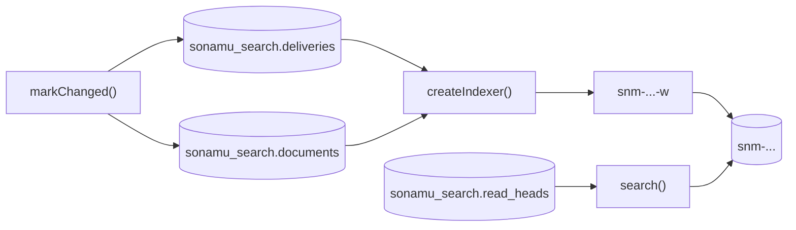

`@sonamu-kit/opensearch`는 Sonamu 애플리케이션의 PostgreSQL 데이터를 OpenSearch에 색인하고 검색하는 선택 패키지입니다. 도메인 트랜잭션마다 어떤 문서가 바뀌었는지 PostgreSQL에 기록하고, 별도의 워커가 그 기록을 읽어 OpenSearch에 반영합니다. 검색은 PostgreSQL 카탈로그가 가리키는 인덱스에서만 합니다.

이 페이지에서 패키지가 애플리케이션에 맞는지 판단한 뒤 [설치와 설정](/ko/advanced-features/opensearch/setup)으로 넘어가세요.

## 하는 일과 하지 않는 일

패키지가 하는 일:

- 색인 의도를 도메인 쓰기와 같은 PostgreSQL 트랜잭션에 기록합니다. 도메인 쓰기 중에는 OpenSearch에 요청을 보내지 않습니다.
- 워커가 그 의도를 OpenSearch에 반영합니다. 같은 문서를 여러 번 보내거나 요청이 늦게 도착해도 가장 높은 리비전이 남습니다.
- 정의가 바뀌면 새 인덱스를 PostgreSQL 원본에서 채운 뒤, 읽기 포인터를 옮겨 검색을 새 인덱스로 전환합니다.
- 검색 본문으로 OpenSearch DSL을 그대로 받고, 패키지가 허용하는 키만 통과시킵니다.

패키지가 하지 않는 일:

- 테이블 변경을 감지하지 않습니다. CDC도, 트리거도, 엔티티 데코레이터도 없으므로 색인에 영향을 주는 쓰기 경로마다 애플리케이션이 `markChanged`를 호출합니다.
- 서버를 시작할 때 스키마나 인덱스를 만들지 않습니다. 스키마는 애플리케이션의 마이그레이션이 설치하고, 인덱스는 운영자가 관리 명령으로 만듭니다.
- 분석기, 사전, 매핑을 제공하지 않습니다. 정의에 OpenSearch 설정 JSON을 그대로 적습니다.
- 권한을 판단하지 않습니다. 검색 결과를 누구에게 보여도 되는지는 애플리케이션이 정합니다.

## 보장하는 것과 보장하지 않는 것

| 성질 | 동작 |
| --- | --- |
| 도메인 쓰기와 색인 의도 | 같은 연결, 같은 트랜잭션에서 기록됩니다. 의도를 기록하지 못하면 그 트랜잭션은 커밋되지 않습니다(실패 닫힘). |
| 전달 | 최소 한 번(at-least-once)입니다. 같은 문서가 여러 번 전송될 수 있습니다. |
| 순서 | 문서마다 원장 리비전을 OpenSearch 외부 버전으로 보냅니다. 낮은 리비전의 늦은 요청은 엔진이 거부합니다. |
| 검색 가시성 | 결과적 일관성입니다. 커밋 뒤 워커가 처리하고, 인덱스 refresh가 지난 다음에 검색됩니다. |
| OpenSearch 장애 | 도메인 쓰기는 계속됩니다. 의도는 PostgreSQL에 쌓이고, 장애가 끝나면 워커가 처리합니다. |
| 검색 결과 | 후보입니다. 권한이 확인된 레코드가 아닙니다. |

패키지가 보장하지 않는 것:

- **정확히 한 번 전달하지 않습니다.** 같은 리비전을 두 번 보내면 두 번째 요청은 버전 충돌로 실패하고, 워커는 색인된 내용이 보내려던 내용과 같은지 확인한 뒤에만 완료로 기록합니다.
- **커밋과 검색 결과가 함께 바뀌지 않습니다.** 방금 커밋한 변경이 바로 검색된다고 가정하는 코드는 틀립니다.
- **무한한 버퍼가 아닙니다.** 워커가 멈춰 있는 동안 의도와 원장 행은 PostgreSQL에 계속 쌓입니다. 대기(`backlog`)를 감시하세요.

검색 결과가 후보인 것은 색인이 늦을 수 있기 때문입니다. 지운 레코드의 tombstone이 아직 색인되지 않았을 수 있고, 색인 뒤에 권한이나 본문이 바뀌었을 수 있습니다. 응답하기 전에 결과의 ID로 primary에서 현재 레코드와 권한을 다시 확인하세요. 방법은 [검색](/ko/advanced-features/opensearch/searching)에 있습니다.

## 구성 요소

- **원장(`documents`)**: 문서마다 리비전 하나를 두고, `markChanged`가 호출될 때마다 1씩 올립니다. 문서를 지워도 원장 행은 남습니다.
- **의도(`deliveries`)**: 대상마다 "이 문서를 이 리비전까지 보내야 한다"는 행입니다. 아웃박스 역할을 합니다.
- **워커**: 의도를 임대(`lease`)와 함께 claim하고, primary의 읽기 전용 스냅샷에서 projection을 실행해, 결과를 bulk 요청으로 보냅니다.
- **대상(target)**: 버전이 붙은 물리 인덱스 `snm-<namespace>-<logical key>-<대상 ID>`와, 워커가 쓰는 alias `<물리 인덱스>-w`입니다. 정의가 바뀌면 새 대상을 만듭니다.
- **읽기 포인터(`read_heads`)**: 검색이 어느 대상을 읽을지 정합니다. OpenSearch alias가 아니라 PostgreSQL에 있으므로 cutover와 rollback이 트랜잭션으로 일어납니다.

이 테이블은 모두 전용 스키마(기본 `sonamu_search`)에 있습니다. `public`에 두지 않으며 Sonamu 엔티티도 아닙니다.

### 세 가지 핸들

쓰기 표시, 색인, 검색은 서로 독립된 핸들입니다.

| 핸들 | 만드는 함수 | 하는 일 |
| --- | --- | --- |
| 동기화 | `createPostgresSynchronization` | 도메인 트랜잭션 안에서 의도를 기록합니다 |
| 워커 | `createIndexer` | 의도를 OpenSearch에 반영합니다 |
| 검색 | `createSearchQueries`, `createSonamuSearchQueries` | 읽기 포인터가 가리키는 대상을 검색합니다 |

그래서 API 프로세스는 표시와 검색만 하고 워커는 다른 프로세스에서 돌릴 수 있습니다. 핸들을 만들 때는 연결, 타이머, 스키마 접근이 생기지 않고, 실제 연산이나 `start()`를 호출할 때만 연결합니다. 패키지를 설치하는 것만으로는 아무것도 켜지지 않습니다.

## 애플리케이션이 맡는 것

- **projection**: 원본 행을 검색 문서로 바꾸는 함수와 그 문서의 스키마입니다. [검색 정의](/ko/advanced-features/opensearch/definitions)를 보세요.
- **매핑, 설정, 분석기**: 정의의 `settings`와 `mappings`에 OpenSearch JSON을 그대로 적습니다. 패키지는 형태만 검사합니다.
- **권한**: 검색 필터, 그리고 검색 결과를 primary에서 다시 확인하는 일입니다.
- **모든 쓰기 경로의 표시**: 생성, 수정, 삭제, 그리고 데이터베이스가 스스로 하는 변경(외래 키의 CASCADE, SET NULL)까지 빠짐없이 `markChanged`를 호출해야 합니다. 표시하지 않은 변경은 색인에 반영되지 않습니다. [트랜잭션 색인](/ko/advanced-features/opensearch/transactional-indexing)을 보세요.
- **운영**: PostgreSQL 역할과 OpenSearch 자격 증명, 인덱스 생성과 cutover 실행, 대기 감시입니다.

## 지원 버전

| 구성 요소 | 범위 | 비고 |
| --- | --- | --- |
| OpenSearch | 3.5.0 이상 4 미만 | 통합 테스트는 3.5.0 이미지를 기본으로 쓰고, 3.9.0 이미지로 바꿔 돌릴 수 있습니다 |
| PostgreSQL | 18 | 이 버전에서만 검증합니다 |
| `@opensearch-project/opensearch` | `^3.9.0` | peer 의존성. 클라이언트는 애플리케이션이 만들어 넘깁니다 |
| `knex` | `^3.3.0` | peer 의존성 |
| `sonamu` | `>=0.13.9` | 선택 peer 의존성. `/sonamu` 진입점에서만 필요합니다 |
| Node.js | 24 이상 | |

### 분석기 플러그인

패키지는 분석기를 포함하지도 요구하지도 않습니다. 형태소 분석기가 필요하면 OpenSearch 플러그인을 클러스터에 직접 설치하고, 정의의 `requiredPlugins`에 이름을 적습니다. 관리 핸들은 이 목록을 두 시점에 확인합니다.

- `planCreate`는 모든 노드를 확인해 빠진 플러그인을 `missingPlugins`에 담고, `plugins-missing` 경고만 붙입니다.
- 실제 생성(`executeCreate`, 그리고 같은 경로를 쓰는 `beginRebuild`)은 빠진 플러그인이 있으면 원격 명령이나 PostgreSQL 기록 없이 `plugins-missing`으로 거부합니다.

플러그인은 엔진 버전에 묶여 있습니다. 다음은 2026년 11월에 공식 이미지로 관찰한 결과이며 패키지가 테스트하는 내용은 아닙니다. OpenSearch 3.5.0에는 `analysis-nori`와 `analysis-sudachi` 3.6.0이 모두 설치됐고, OpenSearch 3.9.0에는 Sudachi 플러그인이 설치되지 않았습니다. 그 플러그인의 최신 릴리스가 3.5.0을 대상으로 했기 때문입니다. 일본어 분석이 필요하면 엔진 버전을 올리기 전에 플러그인 지원을 직접 확인하세요.

## 다음 단계

<CardGroup cols={2}>
  <Card title="설치와 설정" icon="gear" href="/ko/advanced-features/opensearch/setup">
    스키마 마이그레이션, 역할, 클라이언트, 권장 설정값
  </Card>
  <Card title="검색 정의" icon="code" href="/ko/advanced-features/opensearch/definitions">
    projection, 매핑, fingerprint
  </Card>
  <Card title="트랜잭션 색인" icon="database" href="/ko/advanced-features/opensearch/transactional-indexing">
    도메인 쓰기와 함께 변경 표시하기
  </Card>
  <Card title="색인 워커" icon="gears" href="/ko/advanced-features/opensearch/worker">
    워커 실행, 결과 분류, 모니터링
  </Card>
</CardGroup>
