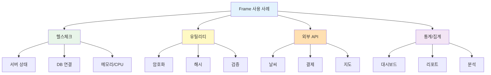

Frame을 활용한 실전 사용 사례를 알아봅니다.

## 사용 사례 개요

<CardGroup cols={2}>
  <Card title="헬스체크" icon="heart-pulse">
    서버 상태 모니터링 DB, 메모리, 업타임
  </Card>
  <Card title="유틸리티" icon="wrench">
    해시, 암호화, UUID 문자열 처리
  </Card>
  <Card title="외부 API" icon="cloud">
    날씨, 지도, 결제 API 프록시
  </Card>
  <Card title="통계/집계" icon="chart-line">
    대시보드 데이터 다중 테이블 집계
  </Card>
</CardGroup>

## 1. 헬스체크 & 모니터링

### 기본 헬스체크

```typescript
// health.frame.ts
import { BaseFrameClass, api } from "sonamu";

class HealthFrame extends BaseFrameClass {
  frameName = "Health";

  @api({ httpMethod: "GET" })
  async check(): Promise<{
    status: "ok" | "error";
    timestamp: Date;
    uptime: number;
  }> {
    return {
      status: "ok",
      timestamp: new Date(),
      uptime: process.uptime(),
    };
  }

  @api({ httpMethod: "GET" })
  async ping(): Promise<{ pong: string }> {
    return { pong: "pong" };
  }
}

export const HealthFrameInstance = new HealthFrame();
```

**사용**:

```bash
# Kubernetes liveness probe
curl http://api.example.com/api/health/ping

# 모니터링 시스템
curl http://api.example.com/api/health/check
```

### 상세 헬스체크

```typescript
interface HealthDetailResponse {
  status: "healthy" | "degraded" | "unhealthy";
  timestamp: Date;
  uptime: number;
  system: {
    memory: {
      total: number;
      used: number;
      free: number;
      percentage: number;
    };
    cpu: {
      model: string;
      cores: number;
      loadAverage: number[];
    };
  };
  services: {
    database: {
      status: "connected" | "disconnected";
      responseTime?: number;
    };
    redis?: {
      status: "connected" | "disconnected";
      responseTime?: number;
    };
  };
}

class HealthFrame extends BaseFrameClass {
  frameName = "Health";

  // OS·메모리·DB 상태를 노출하므로 관리자만 조회
  @api({ httpMethod: "GET", guards: ["admin"] })
  async detail(): Promise<HealthDetailResponse> {
    const startTime = Date.now();

    // DB 연결 체크
    let dbStatus: "connected" | "disconnected" = "disconnected";
    let dbResponseTime: number | undefined;

    try {
      const rdb = this.getPuri("r");
      const dbStart = Date.now();
      await rdb.raw("SELECT 1");
      dbResponseTime = Date.now() - dbStart;
      dbStatus = "connected";
    } catch (error) {
      console.error("Database health check failed:", error);
    }

    // 메모리 정보
    const memoryUsage = process.memoryUsage();
    const totalMemory = memoryUsage.heapTotal;
    const usedMemory = memoryUsage.heapUsed;
    const freeMemory = totalMemory - usedMemory;

    // CPU 정보
    const os = require("os");
    const cpus = os.cpus();

    // 전체 상태 결정
    let overallStatus: "healthy" | "degraded" | "unhealthy";

    if (dbStatus === "disconnected") {
      overallStatus = "unhealthy";
    } else if (usedMemory / totalMemory > 0.9) {
      overallStatus = "degraded";
    } else {
      overallStatus = "healthy";
    }

    return {
      status: overallStatus,
      timestamp: new Date(),
      uptime: process.uptime(),
      system: {
        memory: {
          total: totalMemory,
          used: usedMemory,
          free: freeMemory,
          percentage: (usedMemory / totalMemory) * 100,
        },
        cpu: {
          model: cpus[0]?.model || "unknown",
          cores: cpus.length,
          loadAverage: os.loadavg(),
        },
      },
      services: {
        database: {
          status: dbStatus,
          responseTime: dbResponseTime,
        },
      },
    };
  }
}
```

## 2. 암호화 & 보안 유틸리티

### 해시 & 암호화

```typescript
// crypto.frame.ts
import { BadRequestException, BaseFrameClass, api } from "sonamu";
import crypto from "crypto";
import bcrypt from "bcrypt";
import jwt from "jsonwebtoken";

// bcrypt cost는 클라이언트가 아니라 서버가 정합니다. cost가 1 오를 때마다 계산 시간이 두 배가 되고,
// bcrypt는 libuv 스레드풀(기본 4개)에서 돌기 때문에 높은 cost 요청 몇 개로 같은 풀을 쓰는
// 파일·압축·DNS 작업까지 함께 멈춥니다.
const BCRYPT_COST = 12;

// 암호화 키와 JWT secret은 요청으로 받지 않고 서버에만 둡니다.
function getEncryptionKey(): Buffer {
  const key = Buffer.from(process.env.ENCRYPTION_KEY ?? "", "base64");
  if (key.length !== 32) {
    throw new Error("ENCRYPTION_KEY에는 32바이트 키를 base64로 넣어야 합니다");
  }
  return key;
}

interface HashParams {
  text: string;
  algorithm: "md5" | "sha256" | "sha512" | "bcrypt";
}

class CryptoFrame extends BaseFrameClass {
  frameName = "Crypto";

  // 해시 생성
  @api({ httpMethod: "POST", guards: ["user"] })
  async hash(params: HashParams): Promise<{ hash: string }> {
    if (params.algorithm === "bcrypt") {
      const hash = await bcrypt.hash(params.text, BCRYPT_COST);
      return { hash };
    }

    const hash = crypto.createHash(params.algorithm).update(params.text).digest("hex");

    return { hash };
  }

  // bcrypt 검증
  @api({ httpMethod: "POST", guards: ["user"] })
  async verifyHash(params: { text: string; hash: string }): Promise<{ valid: boolean }> {
    // bcrypt.compare는 해시에 적힌 cost를 그대로 쓰므로, cost가 서버 상한을 넘는 해시는 계산 전에 거부
    const match = /^\$2[aby]\$(\d{2})\$[./A-Za-z0-9]{53}$/.exec(params.hash);
    if (!match || Number(match[1]) > BCRYPT_COST) {
      throw new BadRequestException("지원하지 않는 해시입니다");
    }

    const valid = await bcrypt.compare(params.text, params.hash);
    return { valid };
  }

  // AES-256-GCM 암호화 (무결성 검증 포함)
  // user 가드는 로그인만 확인하므로, 실제 서비스에서는 호출자가 소유한 데이터만 다루도록 범위를 제한하세요
  @api({ httpMethod: "POST", guards: ["user"] })
  async encrypt(params: { plaintext: string }): Promise<{
    ciphertext: string;
    iv: string;
    tag: string;
  }> {
    const iv = crypto.randomBytes(12);
    const cipher = crypto.createCipheriv("aes-256-gcm", getEncryptionKey(), iv);
    const ciphertext = Buffer.concat([cipher.update(params.plaintext, "utf8"), cipher.final()]);

    return {
      ciphertext: ciphertext.toString("base64"),
      iv: iv.toString("base64"),
      tag: cipher.getAuthTag().toString("base64"),
    };
  }

  // AES-256-GCM 복호화
  @api({ httpMethod: "POST", guards: ["user"] })
  async decrypt(params: { ciphertext: string; iv: string; tag: string }): Promise<{
    plaintext: string;
  }> {
    const key = getEncryptionKey();

    try {
      const decipher = crypto.createDecipheriv("aes-256-gcm", key, Buffer.from(params.iv, "base64"), {
        authTagLength: 16,
      });
      decipher.setAuthTag(Buffer.from(params.tag, "base64"));
      const plaintext = Buffer.concat([
        decipher.update(Buffer.from(params.ciphertext, "base64")),
        decipher.final(),
      ]);

      return { plaintext: plaintext.toString("utf8") };
    } catch {
      // 실패 원인(태그 불일치, 길이 오류 등)을 구분하지 않고 같은 오류로 응답
      throw new BadRequestException("복호화할 수 없습니다");
    }
  }

  // JWT 토큰 검증 (간단 버전)
  @api({ httpMethod: "POST", guards: ["user"] })
  async verifyToken(params: { token: string }): Promise<{
    valid: boolean;
    payload?: any;
    error?: string;
  }> {
    try {
      // 서버의 secret과 허용 알고리즘으로만 검증
      const payload = jwt.verify(params.token, process.env.JWT_SECRET ?? "", {
        algorithms: ["HS256"],
      });

      return {
        valid: true,
        payload,
      };
    } catch (error) {
      return {
        valid: false,
        error: error instanceof Error ? error.message : "Unknown error",
      };
    }
  }

  // UUID 생성
  @api({ httpMethod: "POST" })
  async uuid(): Promise<{ uuid: string }> {
    return { uuid: crypto.randomUUID() };
  }

  // 랜덤 문자열 생성
  @api({ httpMethod: "POST" })
  async randomString(params: {
    length: number;
    charset?: "alphanumeric" | "hex" | "base64";
  }): Promise<{ random: string }> {
    const length = Math.min(params.length, 1024);
    const charset = params.charset || "alphanumeric";

    let random: string;

    switch (charset) {
      case "hex":
        random = crypto
          .randomBytes(Math.ceil(length / 2))
          .toString("hex")
          .slice(0, length);
        break;
      case "base64":
        random = crypto
          .randomBytes(Math.ceil((length * 3) / 4))
          .toString("base64")
          .slice(0, length);
        break;
      case "alphanumeric":
      default:
        const chars = "ABCDEFGHIJKLMNOPQRSTUVWXYZabcdefghijklmnopqrstuvwxyz0123456789";
        random = Array.from(crypto.randomBytes(length))
          .map((byte) => chars[byte % chars.length])
          .join("");
        break;
    }

    return { random };
  }
}

export const CryptoFrameInstance = new CryptoFrame();
```

## 3. 외부 API 프록시

### 날씨 API

```typescript
// weather.frame.ts
import { BaseFrameClass, api } from "sonamu";
import axios from "axios";

class WeatherFrame extends BaseFrameClass {
  frameName = "Weather";

  private apiKey = process.env.OPENWEATHER_API_KEY || "";
  private baseUrl = "https://api.openweathermap.org/data/2.5";

  @api({ httpMethod: "GET" })
  async current(params: {
    city: string;
    country?: string;
    units?: "metric" | "imperial";
  }): Promise<{
    city: string;
    country: string;
    temperature: number;
    feelsLike: number;
    condition: string;
    description: string;
    humidity: number;
    windSpeed: number;
    pressure: number;
    visibility: number;
    timestamp: Date;
  }> {
    const query = params.country ? `${params.city},${params.country}` : params.city;

    try {
      const response = await axios.get(`${this.baseUrl}/weather`, {
        params: {
          q: query,
          appid: this.apiKey,
          units: params.units || "metric",
        },
        timeout: 5000,
      });

      const data = response.data;

      return {
        city: data.name,
        country: data.sys.country,
        temperature: data.main.temp,
        feelsLike: data.main.feels_like,
        condition: data.weather[0].main,
        description: data.weather[0].description,
        humidity: data.main.humidity,
        windSpeed: data.wind.speed,
        pressure: data.main.pressure,
        visibility: data.visibility,
        timestamp: new Date(),
      };
    } catch (error) {
      if (axios.isAxiosError(error)) {
        throw new Error(`Weather API error: ${error.message}`);
      }
      throw new Error("Failed to fetch weather data");
    }
  }

  @api({ httpMethod: "GET" })
  async forecast(params: { city: string; country?: string; days?: number }): Promise<{
    city: string;
    forecast: Array<{
      date: string;
      temperature: {
        min: number;
        max: number;
        avg: number;
      };
      condition: string;
      humidity: number;
      windSpeed: number;
    }>;
  }> {
    const query = params.country ? `${params.city},${params.country}` : params.city;

    const days = Math.min(params.days || 5, 7);

    try {
      const response = await axios.get(`${this.baseUrl}/forecast`, {
        params: {
          q: query,
          appid: this.apiKey,
          units: "metric",
          cnt: days * 8, // 3시간 간격 데이터
        },
        timeout: 5000,
      });

      const data = response.data;

      // 일별로 그룹화
      const dailyData = new Map<string, any[]>();

      data.list.forEach((item: any) => {
        const date = item.dt_txt.split(" ")[0];
        if (!dailyData.has(date)) {
          dailyData.set(date, []);
        }
        dailyData.get(date)!.push(item);
      });

      const forecast = Array.from(dailyData.entries()).map(([date, items]) => {
        const temps = items.map((i) => i.main.temp);
        const conditions = items.map((i) => i.weather[0].main);

        return {
          date,
          temperature: {
            min: Math.min(...temps),
            max: Math.max(...temps),
            avg: temps.reduce((a, b) => a + b, 0) / temps.length,
          },
          condition: conditions[0], // 첫 번째 조건 사용
          humidity: items[0].main.humidity,
          windSpeed: items[0].wind.speed,
        };
      });

      return {
        city: data.city.name,
        forecast,
      };
    } catch (error) {
      throw new Error("Failed to fetch forecast data");
    }
  }
}

export const WeatherFrameInstance = new WeatherFrame();
```

### 결제 게이트웨이 프록시

```typescript
// payment.frame.ts
import { BadRequestException, BaseFrameClass, NotFoundException, Sonamu, api } from "sonamu";
import axios from "axios";

class PaymentFrame extends BaseFrameClass {
  frameName = "Payment";

  private stripeApiKey = process.env.STRIPE_SECRET_KEY || "";
  private stripeBaseUrl = "https://api.stripe.com/v1";

  @api({ httpMethod: "POST", guards: ["user"] })
  async createPaymentIntent(params: { orderId: number }): Promise<{
    clientSecret: string;
    paymentIntentId: string;
  }> {
    const { user } = Sonamu.getContext();

    // 금액과 통화는 클라이언트 값이 아니라 로그인한 사용자의 주문 정보로 서버가 정함
    const order = await this.getPuri("r")
      .table("orders")
      .where("id", params.orderId)
      .where("user_id", user!.id)
      .select({ amount: "amount", currency: "currency" })
      .first();
    if (!order) {
      throw new NotFoundException("주문을 찾을 수 없습니다");
    }

    try {
      const response = await axios.post(
        `${this.stripeBaseUrl}/payment_intents`,
        new URLSearchParams({
          amount: String(order.amount), // 센트 단위
          currency: order.currency,
        }),
        {
          headers: {
            Authorization: `Bearer ${this.stripeApiKey}`,
            "Content-Type": "application/x-www-form-urlencoded",
          },
        },
      );

      return {
        clientSecret: response.data.client_secret,
        paymentIntentId: response.data.id,
      };
    } catch (error) {
      throw new Error("Failed to create payment intent");
    }
  }

  @api({ httpMethod: "POST", guards: ["user"] })
  async verifyPayment(params: { paymentIntentId: string }): Promise<{
    status: string;
    amount: number;
    currency: string;
    paid: boolean;
  }> {
    // 형식 검사는 소유권 확인이 아니므로, 실제 서비스에서는 이 intent가 로그인 사용자의 주문에 연결된 것인지 서버에 저장한 값으로 확인하세요
    // 서버 비밀키로 호출하는 경로에 들어가므로 Stripe ID 형식만 허용 (경로 조작 차단)
    if (!/^pi_[A-Za-z0-9]+$/.test(params.paymentIntentId)) {
      throw new BadRequestException("잘못된 결제 ID입니다");
    }

    try {
      const response = await axios.get(
        `${this.stripeBaseUrl}/payment_intents/${encodeURIComponent(params.paymentIntentId)}`,
        {
          headers: {
            Authorization: `Bearer ${this.stripeApiKey}`,
          },
        },
      );

      return {
        status: response.data.status,
        amount: response.data.amount,
        currency: response.data.currency,
        paid: response.data.status === "succeeded",
      };
    } catch (error) {
      throw new Error("Failed to verify payment");
    }
  }
}

export const PaymentFrameInstance = new PaymentFrame();
```

## 4. 통계 & 대시보드

### 관리자 대시보드

```typescript
// admin-stats.frame.ts
import { BaseFrameClass, api } from "sonamu";

interface DashboardStats {
  users: {
    total: number;
    active: number;
    newToday: number;
    newThisWeek: number;
    newThisMonth: number;
    byRole: {
      admin: number;
      manager: number;
      normal: number;
    };
  };
  content: {
    totalPosts: number;
    totalComments: number;
    postsToday: number;
    commentsToday: number;
  };
  engagement: {
    averagePostsPerUser: number;
    averageCommentsPerPost: number;
    mostActiveUsers: Array<{
      userId: number;
      username: string;
      postCount: number;
    }>;
  };
  system: {
    databaseSize: number;
    cacheHitRate: number;
    averageResponseTime: number;
  };
}

class AdminStatsFrame extends BaseFrameClass {
  frameName = "AdminStats";

  @api({ httpMethod: "GET", guards: ["admin"] })
  async dashboard(): Promise<DashboardStats> {
    const rdb = this.getPuri("r");

    // 날짜 계산
    const today = new Date();
    today.setHours(0, 0, 0, 0);

    const weekAgo = new Date(today);
    weekAgo.setDate(weekAgo.getDate() - 7);

    const monthAgo = new Date(today);
    monthAgo.setMonth(monthAgo.getMonth() - 1);

    // 사용자 통계
    const { totalUsers } = await rdb
      .table("users")
      .select({ totalUsers: Puri.count() })
      .first();

    const { activeUsers } = await rdb
      .table("users")
      .where("is_active", true)
      .select({ activeUsers: Puri.count() })
      .first();

    const { newToday } = await rdb
      .table("users")
      .where("created_at", ">=", today)
      .select({ newToday: Puri.count() })
      .first();

    const { newThisWeek } = await rdb
      .table("users")
      .where("created_at", ">=", weekAgo)
      .select({ newThisWeek: Puri.count() })
      .first();

    const { newThisMonth } = await rdb
      .table("users")
      .where("created_at", ">=", monthAgo)
      .select({ newThisMonth: Puri.count() })
      .first();

    // 역할별 통계
    const roleStats = await rdb
      .table("users")
      .select({ role: "role", count: Puri.count() })
      .groupBy("role");

    const byRole = {
      admin: roleStats.find((s) => s.role === "admin")?.count || 0,
      manager: roleStats.find((s) => s.role === "manager")?.count || 0,
      normal: roleStats.find((s) => s.role === "normal")?.count || 0,
    };

    // 콘텐츠 통계
    const { totalPosts } = await rdb
      .table("posts")
      .select({ totalPosts: Puri.count() })
      .first();

    const { totalComments } = await rdb
      .table("comments")
      .select({ totalComments: Puri.count() })
      .first();

    const { postsToday } = await rdb
      .table("posts")
      .where("created_at", ">=", today)
      .select({ postsToday: Puri.count() })
      .first();

    const { commentsToday } = await rdb
      .table("comments")
      .where("created_at", ">=", today)
      .select({ commentsToday: Puri.count() })
      .first();

    // 참여도 통계
    const averagePostsPerUser = totalUsers > 0 ? totalPosts / totalUsers : 0;

    const averageCommentsPerPost = totalPosts > 0 ? totalComments / totalPosts : 0;

    // 가장 활동적인 사용자
    const mostActiveUsers = await rdb
      .table("posts")
      .join("users", "posts.user_id", "users.id")
      .select({
        userId: "posts.user_id",
        username: "users.username",
        postCount: Puri.count(),
      })
      .groupBy("posts.user_id", "users.username")
      .orderBy("postCount", "desc")
      .limit(5);

    return {
      users: {
        total: totalUsers,
        active: activeUsers,
        newToday,
        newThisWeek,
        newThisMonth,
        byRole,
      },
      content: {
        totalPosts,
        totalComments,
        postsToday,
        commentsToday,
      },
      engagement: {
        averagePostsPerUser,
        averageCommentsPerPost,
        mostActiveUsers,
      },
      system: {
        databaseSize: 0, // TODO: 구현
        cacheHitRate: 0, // TODO: 구현
        averageResponseTime: 0, // TODO: 구현
      },
    };
  }
}

export const AdminStatsFrameInstance = new AdminStatsFrame();
```

## 5. 검증 & 유효성 체크

```typescript
// validation.frame.ts
import { BaseFrameClass, api } from "sonamu";
import axios from "axios";
import dns from "dns";
import http from "http";
import https from "https";
import net from "net";

// 외부에 공개되지 않은 IPv4 대역 (사설망, 루프백, 링크로컬·클라우드 메타데이터, CGNAT, 멀티캐스트 등)
const NON_PUBLIC_IPV4 = new net.BlockList();
for (const [address, prefix] of [
  ["0.0.0.0", 8],
  ["10.0.0.0", 8],
  ["100.64.0.0", 10],
  ["127.0.0.0", 8],
  ["169.254.0.0", 16],
  ["172.16.0.0", 12],
  ["192.0.0.0", 24],
  ["192.0.2.0", 24],
  ["192.168.0.0", 16],
  ["198.18.0.0", 15],
  ["198.51.100.0", 24],
  ["203.0.113.0", 24],
  ["224.0.0.0", 3],
] as const) {
  NON_PUBLIC_IPV4.addSubnet(address, prefix, "ipv4");
}

// IPv6는 전역 유니캐스트(2000::/3)만 허용하고, 그 안의 문서용·6to4 대역은 제외
// (::1, fc00::/7, fe80::/10, IPv4-mapped ::ffff:0:0/96 등은 모두 거부됨)
const GLOBAL_IPV6 = new net.BlockList();
GLOBAL_IPV6.addSubnet("2000::", 3, "ipv6");
const NON_PUBLIC_IPV6 = new net.BlockList();
NON_PUBLIC_IPV6.addSubnet("2001:db8::", 32, "ipv6");
NON_PUBLIC_IPV6.addSubnet("2002::", 16, "ipv6");

function isPublicAddress(address: string): boolean {
  if (net.isIPv4(address)) {
    return !NON_PUBLIC_IPV4.check(address, "ipv4");
  }
  if (net.isIPv6(address)) {
    return GLOBAL_IPV6.check(address, "ipv6") && !NON_PUBLIC_IPV6.check(address, "ipv6");
  }
  return false;
}

// 소켓을 열기 직전에 DNS 결과를 검사합니다. 검사한 주소로 바로 연결하므로
// 검사 뒤에 DNS 응답을 바꾸는 DNS rebinding도 통하지 않습니다.
const publicOnlyLookup: net.LookupFunction = (hostname, options, callback) => {
  dns.lookup(hostname, { ...options, all: true }, (error, addresses) => {
    if (error) {
      callback(error, "");
      return;
    }
    if (addresses.length === 0 || !addresses.every((a) => isPublicAddress(a.address))) {
      callback(new Error(`내부 주소로 해석되는 호스트입니다: ${hostname}`), "");
      return;
    }
    if (options.all) {
      callback(null, addresses);
    } else {
      callback(null, addresses[0].address, addresses[0].family);
    }
  });
};

// 사용자가 준 URL에 요청할 때만 쓰는 axios 인스턴스
const publicOnlyHttp = axios.create({
  httpAgent: new http.Agent({ lookup: publicOnlyLookup }),
  httpsAgent: new https.Agent({ lookup: publicOnlyLookup }),
  proxy: false, // 프록시를 거치면 lookup 검사가 프록시 주소에만 적용되므로 끔
  maxRedirects: 0, // 리다이렉트 대상(IP 리터럴 포함)을 다시 검사할 수 없으므로 따라가지 않음
  maxContentLength: 1024 * 1024, // 응답 본문 1MiB 상한
  timeout: 5000,
});

class ValidationFrame extends BaseFrameClass {
  frameName = "Validation";

  // 이메일 검증
  @api({ httpMethod: "POST", guards: ["user"] })
  async validateEmail(params: { email: string; checkDns?: boolean }): Promise<{
    valid: boolean;
    format: boolean;
    domain: boolean;
    message?: string;
  }> {
    // 형식 검증
    const emailRegex = /^[^\s@]+@[^\s@]+\.[^\s@]+$/;
    const formatValid = emailRegex.test(params.email);

    if (!formatValid) {
      return {
        valid: false,
        format: false,
        domain: false,
        message: "Invalid email format",
      };
    }

    // 도메인 검증
    let domainValid = true;
    const domain = params.email.split("@")[1];

    if (params.checkDns) {
      try {
        await dns.promises.resolveMx(domain);
      } catch (error) {
        domainValid = false;
      }
    }

    return {
      valid: formatValid && domainValid,
      format: formatValid,
      domain: domainValid,
      message: !domainValid ? "Domain does not exist or has no MX records" : undefined,
    };
  }

  // URL 검증
  @api({ httpMethod: "POST", guards: ["user"] })
  async validateUrl(params: { url: string; checkReachable?: boolean }): Promise<{
    valid: boolean;
    format: boolean;
    reachable?: boolean;
    statusCode?: number;
    message?: string;
  }> {
    // 형식 검증
    let urlObj: URL;
    try {
      urlObj = new URL(params.url);
    } catch (error) {
      return {
        valid: false,
        format: false,
        message: "Invalid URL format",
      };
    }

    // HTTP/HTTPS만 허용
    if (!["http:", "https:"].includes(urlObj.protocol)) {
      return {
        valid: false,
        format: false,
        message: "Only HTTP/HTTPS protocols are supported",
      };
    }

    // IP 주소로 쓴 호스트는 DNS 조회(lookup)를 거치지 않으므로 여기서 직접 검사
    const host = urlObj.hostname.replace(/^\[(.*)\]$/, "$1");
    if (net.isIP(host) !== 0 && !isPublicAddress(host)) {
      return {
        valid: false,
        format: true,
        message: "Internal addresses are not allowed",
      };
    }

    // 도달 가능 여부 확인
    let reachable: boolean | undefined;
    let statusCode: number | undefined;

    if (params.checkReachable) {
      try {
        const response = await publicOnlyHttp.head(urlObj.href, {
          validateStatus: () => true, // 모든 상태 코드 허용
        });

        statusCode = response.status;
        reachable = statusCode >= 200 && statusCode < 400;
      } catch (error) {
        reachable = false;
      }
    }

    return {
      valid: true && reachable !== false,
      format: true,
      reachable,
      statusCode,
    };
  }

  // 전화번호 검증 (한국)
  @api({ httpMethod: "POST" })
  async validatePhoneKR(params: { phone: string }): Promise<{
    valid: boolean;
    formatted: string;
    type: "mobile" | "landline" | "unknown";
    message?: string;
  }> {
    // 숫자만 추출
    const digits = params.phone.replace(/\D/g, "");

    // 길이 체크 (10-11자리)
    if (digits.length < 10 || digits.length > 11) {
      return {
        valid: false,
        formatted: params.phone,
        type: "unknown",
        message: "Phone number must be 10-11 digits",
      };
    }

    // 유형 판단
    let type: "mobile" | "landline" | "unknown" = "unknown";
    let formatted: string;

    if (digits.startsWith("010") && digits.length === 11) {
      // 휴대폰
      type = "mobile";
      formatted = `${digits.slice(0, 3)}-${digits.slice(3, 7)}-${digits.slice(7)}`;
    } else if (digits.length === 10) {
      // 지역번호
      type = "landline";
      formatted = `${digits.slice(0, 2)}-${digits.slice(2, 6)}-${digits.slice(6)}`;
    } else {
      formatted = params.phone;
    }

    return {
      valid: type !== "unknown",
      formatted,
      type,
    };
  }
}

export const ValidationFrameInstance = new ValidationFrame();
```

## 사용 패턴 요약



## 다음 단계

<CardGroup cols={2}>
  <Card title="Frame 생성하기" icon="plus" href="/ko/api-development/frames/creating-frames">
    BaseFrameClass 사용법
  </Card>
  <Card title="Frame이란?" icon="circle-question" href="/ko/api-development/frames/what-are-frames">
    Frame 개념 이해하기
  </Card>
  <Card title="@api 데코레이터" icon="at" href="/ko/api-development/creating-apis/api-decorator">
    API 기본 사용법
  </Card>
  <Card title="Model" icon="database" href="/ko/core-concepts/model/what-is-model">
    Entity 기반 API
  </Card>
</CardGroup>
